# PolyPack

**多端打包，一次送达** — Rust 核心 × React UI 适配层 × 50+ 目标平台

[English](README.en.md) · [项目站点](site/index.html) · [详细规划](docs/ROADMAP.md) · [架构](#项目架构) · [平台矩阵](#支持平台矩阵)

> **项目状态：M8 生态 GA 已交付并收口**（2026-10-18，13/13——wasmtime 插件沙箱与 `target-spec/v1` WIT 契约（默认零能力、显式授权与三道上限）、SRI + GPG 分离签名链（CredentialRef 信任根）、独立模板仓库与 `poly plugin new|digest`、内建目标统一 `TargetProvider`（内建即官方插件，无 builtin 特判）、农场 v1（并发/worker 池/超时重试/隔离/共享 CAS）、发布 GA（退避/幂等/回执 v2/`poly retry --from publish`）、49 目标现状表，双语 [GA 文档](docs/GA.md)、技术审查与「1 天新增目标」演练（独立开发者代理 38 min 完成脚手架→自定义出包）。M0–M8 里程碑均已收口（条件任务与环境槽按 TASKS 注记）；M7 细节：adapter-wear 紧凑 tokens、Wear OS 目标与表单冒烟双轨（含发版门）、watchOS SwiftUI 模板与打包/签名链（实验）、Fitbit `.fba` / Zepp `.zab`、Garmin Monkey C spike（实验）、实验目标三段式文档、穿戴契约与金样；xcodebuild / codesign / Wear 设备类环境槽按 SKIP-with-print，garmin 的内建 iq 打包器已接线（monkeyc 环境槽 + 结构自检））。可用命令：`poly doctor` / `poly init` / `poly build`（deb / AppDir / Web 静态包；**Android AAB/APK**；**iOS 未签名 IPA**（macOS 宿主）；**鸿蒙 HAP 打包 + hap-sign-tool 签名校验**；**微信/支付宝/抖音/快应用代码包**（含 wasm 沙箱出口随包）；**TV 家族：android-tv / fire-tv（Leanback）、tvos（复用 Apple 链）、tizen-tv / webos-tv / vidaa-tv / smartcast-tv（web 系）**；**穿戴：Wear OS / Fitbit / Zepp / watchOS※实验 / Garmin※实验**；sign/verify 入 DAG；`[budget]` 体积门禁 warn/fail）/ `poly bridge`（uniffi + **ohos NAPI** + **wasm** 三出口）/ `poly farm worker|submit`（远程农场）/ `poly scan`（密钥扫描）/ `poly verify --reproducible` / `poly targets`（目标矩阵 JSON，供 CI 派生）/ `poly retry --from sign|verify` / `poly plugin new|digest`（插件脚手架与 SRI 摘要） / `poly dev` / `poly clean` / `poly release`（自托管 rpm/deb/pkg 仓库元数据 + 签名 + 回执归档，`--target fedora,freebsd`）。十一工作流三宿主全绿 + `release` 发版工作流（新增 `wear-smoke` 夜跑表单冒烟与 `wear-release-smoke` 发版门；`bsd-ci`：FreeBSD 14.5 QEMU 原生构建 + 安装冒烟真跑；OpenBSD 7.9 为尽力腿，托管 runner 无 KVM、镜像 TCG 起不来时按 SKIP-with-print 留痕；每夜。新增 `embedded-ci`：tier-6 矩阵从 TargetSpec 派生 + QNX / Zephyr / FreeRTOS QEMU 冒烟，缺工具链按 SKIP-with-print 并在 job summary 列 REAL/SKIP；每夜）；tvOS 打包链 macos-14 真跑首证（XCFramework→archive→IPA 7,065B）；Android TV 设备冒烟 6/6 走查 + 「无指针完成核心任务」+ 焦点环像素实证；遥控器冒烟三腿复合 14 场景 / 69 键步全过。里程碑与环境槽注记见 [docs/TASKS.md](docs/TASKS.md)，规划见 [docs/ROADMAP.md](docs/ROADMAP.md)。
>
> **2026-10-19 缺口收口**：`poly release` 按目标凭据、Garmin 内建 `.iq` 打包器、Vault 信任根载体、keyring/zbus 升级、GitHub Releases 二进制与文档一致性已落地；环境槽关闭台账见 [ENV-SLOTS](docs/ENV-SLOTS.md)，未立项方向见 [INITIATIVES](docs/INITIATIVES.md)。
>
> **2026-10-21 · v1.15.0**：M9 收口——SBOM、多应用工作区、`release --changed`、OTA、商店元数据、GUI、设备预览协议、签名插件索引（`poly plugin add/search`）与农场加固已交付；ENV-01/07/11/12/15/16/17/18 已关闭。仍需你提供的凭据 / 授权 / 硬件 / 真人试用入口见 [ENV-PROVIDE](docs/ENV-PROVIDE.md)。新增命令：`poly history`、`poly update`、`poly preview`、`poly deploy line-liff`、`poly verify --sbom`、`poly plugin add|search`。

---

## 认识 Pax


**Pax（帕克斯）** 是 PolyPack 的项目宠物——一只巴掌大的打包机器人。锈橙色的机身致敬 Rust，青色的屏幕脸与轨道邮票呼应 React：它把同一份代码库打包成一件小包裹，贴上运单，再一件件送达手机、手表、电视们手里。圆角纸箱做的身体、短手短腿和头顶的小天线，让它像一个正在送货的卡通小家伙。

Pax 是动态多形态的：空闲时轻轻浮动，并循环展示 **笑 / 欢乐 / 哭 / 沮丧 / 惊恐 / 愤怒 / 撒娇 / 卖萌 / 讨好 / 敲打 / 捂脸 / 吐舌头** 十二种彩色表情；每一个单独的表情也都有自己的动态——哭是泪滴下落、惊恐是发抖加汗滴、愤怒是怒纹加蒸汽、撒娇是爱心上浮、敲打是包裹敲击火星、沮丧是叹气下沉、吐舌头是舌头摆动…… 全部为纯 CSS 动画、无脚本；系统开启「减弱动态效果」时各自定格为对应的静态形态。十二种表情一览（格子里每一只都在动）：



独立表情文件（每个都带自己的动态）：[笑](docs/assets/pax-smile.svg) · [欢乐](docs/assets/pax-joy.svg) · [哭](docs/assets/pax-cry.svg) · [沮丧](docs/assets/pax-dejected.svg) · [惊恐](docs/assets/pax-shock.svg) · [愤怒](docs/assets/pax-angry.svg) · [撒娇](docs/assets/pax-coquettish.svg) · [卖萌](docs/assets/pax-cute.svg) · [讨好](docs/assets/pax-ingratiating.svg) · [敲打](docs/assets/pax-knock.svg) · [捂脸](docs/assets/pax-facepalm.svg) · [吐舌头](docs/assets/pax-tongue.svg)；本地打开 [docs/pax.html](docs/pax.html) 可手动切换表情。

**品牌约定**：Pax 就是 PolyPack 的项目图标——文档 favicon（[pax-mark.svg](docs/assets/pax-mark.svg)）、生成图示右下角的微缩角标、未来的 CLI / GUI / 安装包图标都用它；十二种表情同时映射构建状态（成功 = 欢乐 · 失败 = 哭 · 异常 = 惊恐 · 待确认 = 撒娇 · 空闲 = 笑）。全部形态由 `tools/build-pax.mjs` 单一源生成。

Pax 与全部文档图示共用同一套色彩变量，你会在架构图里再次见到它身上的锈橙与轨道蓝。

## 项目简介

PolyPack 是一个**「一次编写、全端打包」的通用打包工具**：以 Rust 为单一核心，通过声明式目标注册表（TargetSpec）把同一份 **Rust 业务核心 + React 界面** 编译、签名、封装并发布到 **50+ 个目标平台**——从 Android / iOS / HarmonyOS / Windows / macOS / Linux / Web，到小程序、快应用、电视、车机、穿戴、嵌入式 RTOS，乃至主机平台。

### 为什么需要它

- **目标多而散**：多端构建目前各自为战——Android 用 Gradle、iOS 用 Xcode、小程序用各家 IDE、桌面各写一套打包脚本。PolyPack 把它们收敛成一条 `poly` 命令。
- **栈要统一**：业务逻辑用 Rust 写一次，跨端复用；界面用 React 写一次，经平台适配层换成各端组件体系。
- **流程要成链**：探测工具链 → 交叉编译 → UI 打包 → 签名/公证/加固 → 封装 → 商店提审，全链路可编排、可缓存、可复现。
- **生态要可扩展**：新平台 = 一个 TargetSpec + 一个 WASM 插件，不必等官方发版。

### 工作原理（90 秒版）

```bash
poly release --target android,ios,wechat,tizen --publish
```

1. 装载 `polypack.toml`，为目标列表解析出 **TargetSpec**（运行时、打包格式、签名要求、分发渠道）；
2. **工具链探测**：本机缺什么报什么（SDK/NDK/Xcode/emsdk…），构建缓存按内容寻址增量复用；
3. **Rust 交叉编译** + **React 适配层打包**并行展开，产物汇入打包器矩阵；
4. **签名 → 公证 → 加固 → 校验**，最后按目标封装为 APK / IPA / HAP / MSI / DMG / AppImage / wgt / ipk / 小程序包 …… 并生成构建报告。

完整的 13 步旅程见下方[请求周期](#请求周期)。

---

## 支持平台矩阵

| 等级 | 平台 | UI 运行时 | 打包 / 分发 |
|---|---|---|---|
| L1 | Android | React Native · Material 3 | AAB / APK → Google Play |
| L1 | iOS | React Native · HIG | IPA → App Store |
| L1 | HarmonyOS | RN for OpenHarmony · HarmonyOS Design | HAP → AppGallery |
| L1 | Windows | react-dom（Tauri） | MSI / NSIS → MS Store |
| L1 | macOS | react-dom（Tauri） | DMG / PKG + 公证 |
| L1 | Linux | react-dom（Tauri） | AppImage · deb · rpm · Flatpak · Snap |
| L1 | Web | react-dom | 静态包 + PWA |
| L2 | 微信小程序 | Taro（React 语法） | 小程序代码包 → 微信审核 |
| L2 | 支付宝小程序 | Taro | 小程序包 → 支付宝审核 |
| L2 | 抖音小程序 | Taro | 小程序包 → 抖音审核 |
| L2 | 快应用 | Taro / 快应用框架 | .rpk → 联盟商店 |
| L2 | TikTok Minis | HTML5 + Minis 桥 | zip → TikTok 平台 |
| L2 | Google Play Instant | React Native | Instant AAB（已停服，保留规划） |
| L2 | Facebook Instant Games | HTML5 | zip → Meta 平台 |
| L2 | Snapchat Mini | HTML5 | zip → Snap 平台 |
| L2 | LINE Mini App | LIFF（web） | LIFF 应用 → LINE 平台 |
| L3 | Android TV | RN · Leanback | APK → Play（TV 轨道） |
| L3 | Apple tvOS | react-native-tvos | TV 包 → App Store |
| L3 | HarmonyOS TV | RNOH（TV 形态） | HAP → AppGallery Connect（TV） |
| L3 | Samsung Tizen（TV） | react-dom（web 包） | .wgt → Seller Office |
| L3 | LG webOS | react-dom（web 包） | .ipk → LG 内容商店 |
| L3 | Roku OS | 受限渲染器（SceneGraph 子集）※实验 | 频道包 → Roku 渠道 |
| L3 | Amazon Fire TV | React Native（Android） | APK → 亚马逊应用商店 |
| L3 | Vizio SmartCast | react-dom（web 包） | 应用包 → Vizio 平台 |
| L3 | Hisense VIDAA | react-dom（web 包） | 应用包 → VIDAA 商店 |
| L4 | GrapheneOS | React Native（复用 Android 链） | APK → 自签名 / 自托管 |
| L4 | KaiOS | react-dom（web 栈） | zip → KaiStore |
| L4 | Sailfish OS | Qt / Silica 壳 + WebView | RPM → Jolla 商店 |
| L4 | Ubuntu Touch | WebView 壳（Clickable） | .click → OpenStore |
| L5 | Ubuntu | react-dom / Tauri | deb · Snap · Flatpak |
| L5 | Fedora | react-dom / Tauri | rpm · Flatpak |
| L5 | Linux Mint | react-dom / Tauri | deb · Flatpak |
| L5 | Chrome OS | Linux（Crostini）+ PWA | deb + PWA |
| L5 | FreeBSD | 原生构建 | pkg |
| L5 | OpenBSD | 原生构建 | ports |
| L5 | BSD 家族（NetBSD / DragonFly 等） | 原生构建 | pkgsrc 等 |
| L6 | Apple watchOS | 伴生应用（SwiftUI 模板）※实验 | watch 包（Xcode）→ App Store |
| L6 | Wear OS | RN / 轻量运行时（beta）；打包与签名走 Android 基座 | APK（Wear）→ Play |
| L6 | Android Automotive | React Native（Android） | APK → 车厂渠道 |
| L6 | QNX | Rust 核心 + 可选 HMI 层 | 镜像 / 静态库 |
| L6 | AUTOSAR（Adaptive） | 无 UI（核心库） | ARXML / 静态库 |
| L6 | VxWorks | 无 UI（核心库） | 静态库 / 镜像 |
| L6 | RTOS（Zephyr / FreeRTOS） | 无 UI（no_std 核心） | 静态库 |
| L6 | Fitbit OS | Fitbit JS SDK | `.fba` 应用包 → Fitbit Gallery |
| L6 | Garmin（Connect IQ） | Monkey C 转译 ※实验 | `.iq` 包（内建 iq 打包器；monkeyc / devkey 环境槽 → SKIP-with-print；结构自检） |
| L6 | Zepp OS | Zepp JS API | `.zab` 小程序 → Zepp 商店 |
| L7 | PlayStation | 官方 SDK 插件（需授权） | 平台包 |
| L7 | Xbox | GDK 插件（需授权） | 平台包 |
| L7 | Nintendo Switch | NintendoSDK 插件（需授权） | 平台包 |

> 等级说明：**L1** 一等公民，全链路官方支持；**L2** 小程序与即时应用，经 Taro / HTML5 适配层；**L3** 电视与大屏；**L4** 移动系统变体；**L5** 桌面发行版与 BSD；**L6** 穿戴 / 车机 / 嵌入式（部分为无 UI 核心库）；**L7** 主机平台，受厂商授权约束，仅以官方 SDK 插件形式提供。
>
> 清单共 **49 个明确平台**；计入 BSD 家族、RTOS 家族与 Linux 发行版家族后为 **50+ 端**。标记 ※实验 的目标其运行时受限，风险与对策见 [docs/ROADMAP.md](docs/ROADMAP.md) 的风险登记册。

### L6 嵌入式 / 车机状态表（由 TargetSpec 生成）

下表覆盖 L6 嵌入式 / 车机 / 穿戴的十一个已注册目标，字段逐字来自 `crates/poly-targets/src/builtin.rs` 的 `TargetSpec`（`notes` 为声明原文）。请勿手改：运行 `node tools/gen-target-table.mjs` 重新生成；`node tools/gen-target-table.mjs --check` 在表与注册表漂移时失败。

<!-- BEGIN GENERATED: l6-embedded-status -->
| 目标 | 运行时 | 桥 | 打包器与产物 | 签名 | 产物校验 | 发布渠道 | experimental | notes |
| --- | --- | --- | --- | --- | --- | --- | --- | --- |
| `android-automotive` | `native` | `uniffi` | `apk` · `android-aapt2` | `android-keystore` | `apksigner-verify`, `bundletool-validate` | `oem-channel` | `false` | AAOS 清单（android.hardware.type.automotive）；车厂渠道，无统一公开 API——发布需 OEM 凭据引用（占位 Publisher，不伪造提交） |
| `autosar` | `staticlib` | `cffi` | `arxml` · `autosar-adaptive` | — | `arxml-schema`, `c-abi-symbols` | `self-hosted` | `false` | 无 UI、自部署；AUTOSAR Adaptive 清单（ARXML）由 poly_engine_* C ABI 单一来源派生（服务 / 端口与导出符号一一对应）；no_std 可选（引擎层 --no-default-features，应用提供 global_allocator / panic_handler） |
| `fitbit` | `none` | `none` | `fba` · `fitbit-build` | — | `fitbit-structure-check` | `fitbit-gallery` | `false` | 核心不直接运行、能力由 JS 侧实现（runtime = none；Fitbit OS 侧 JS SDK 应用包 `.fba`：应用清单 + device-<family>.zip + 可选 companion.zip，结构同官方 SDK 6.1）；fitbit-build 缺席时 CLI 自检 SKIP-with-print，结构断言真跑；签名 / 提审归 Fitbit Gallery 平台侧 |
| `freertos` | `staticlib` | `cffi` | `board` · `freertos-qemu` | — | `c-abi-symbols`, `freertos-qemu-smoke` | `self-hosted` | `false` | 无 UI、cffi、no_std；FreeRTOS 示例板包（mps2-an385 / Cortex-M3，静态库 + 启动 / 中断 / UART / FreeRTOSConfig / Makefile 工程模板）；内核 V11.1.0 按 tag + sha256 现拉不入库；`make smoke` 在 QEMU 中调用 poly_engine_* 并以 semihosting 退出码 0 结束；arm-none-eabi-gcc / qemu-system-arm / 网络缺席时按环境槽 SKIP-with-print |
| `garmin` | `none` | `none` | `iq` · `garmin-monkeyc` | — | `iq-structure-check` | `connect-iq-store` | `true` | 实验：Monkey C 子集受限转译——仅 UI 子集 + 原生逻辑（Monkey C 重写，无 JS 运行时）；工程结构自检可用，Connect IQ 编译与真机实证待补（T-M7-10 触发前置；能力边界见 ui/adapters/garmin/CAPABILITY-BOUNDARY-DRAFT.md） |
| `qnx` | `staticlib` | `cffi` | `image` · `qnx-sdp` | — | `qnx-image-structure`, `c-abi-symbols`, `qnx-qemu-smoke` | `self-hosted` | `false` | headless 核心（可选 HMI 归平台侧）；静态库 + 部署镜像（附 mkifs buildfile，可引导 .ifs / QEMU 归 T-M6-09）；交叉编译需 QNX SDP（$QNX_HOST / $QNX_TARGET）与 Rust QNX target，无 SDP 时按环境槽 SKIP-with-print，不伪造二进制；自部署 |
| `vxworks` | `staticlib` | `cffi` | `library` · `vxworks-wr` | — | `c-abi-symbols`, `vxworks-ld-check` | `self-hosted` | `false` | 无 UI、cffi、no_std；format = `library`（默认，静态库）或 `image`（部署 kit zip，配置 [targets.vxworks].format 覆盖）；wr-cc / wr-ld 缺席时产物用 nm 符号闭包 + 结构断言校验并 SKIP-with-print，绝不伪造可加载镜像 |
| `watchos` | `none` | `none` | `watch` · `watchos-xcodebuild` | `apple-codesign` | `codesign-verify` | `app-store` | `true` | 实验：SwiftUI 伴生模板（核心 API 调用桩 + WatchConnectivity 说明），核心不直接运行（runtime = none）；模板经 `poly init --target watchos` 生成，macOS 宿主 `xcodebuild` 构建；Linux / Windows 发起走远程农场 macOS worker（R3）；签名复用 M2 Apple 链（codesign，凭据只以 apple-codesign 引用出现） |
| `wearos` | `native` | `uniffi` | `apk` · `android-aapt2` | `android-keystore` | `apksigner-verify`, `bundletool-validate` | `google-play-wear` | `false` | Wear OS 清单（android.hardware.type.watch，minSdkVersion ≥ 26）；UI 运行时（RN on Wear）为 beta，打包与签名走 Android 基座 |
| `zephyr` | `staticlib` | `cffi` | `west` · `zephyr-west` | — | `c-abi-symbols`, `zephyr-west-build`, `zephyr-qemu-smoke` | `self-hosted` | `false` | 无 UI、cffi、no_std；west 工程模板（zephyr module + 引擎静态库模块链入），qemu_x86 / qemu_cortex_m3 两板 `west build` 验收；最小 CONFIG_* 集随模板版本化；west / Zephyr SDK 缺席时按环境槽 SKIP-with-print |
| `zepp` | `none` | `none` | `zab` · `zeus` | — | `zepp-structure-check` | `zepp-store` | `false` | 核心不直接运行、能力由 Zepp JS API 侧实现（runtime = none）；Zepp 小程序 `.zab`（外层 manifest.json + <md5>.zpk，zpk 内含 device.zip / app-side.zip，结构同 zpm）；zeus / 模拟器缺席时安装与工具链校验 SKIP-with-print，结构断言真跑；签名 / 提审归 Zepp 商店平台侧 |
<!-- END GENERATED: l6-embedded-status -->

**`garmin` 打包状态**：T-M7-09 的 Monkey C 转译为 `ui/adapters/garmin` 独立 Node 模块；`poly-bundle` 的内建 `iq` 打包器已交付（`crates/poly-bundle/src/packagers/garmin.rs`），`poly build --target garmin` 会生成 `.iq` 并做结构自检；剩余缺口是 `monkeyc` / devkey 编译腿（环境槽 SKIP-with-print，不伪造编译产物）。`watchos` / `garmin` 的能力 / 缺口 / 替代方案见 [docs/EXPERIMENTAL-TARGETS.md](docs/EXPERIMENTAL-TARGETS.md)；`wearos` 为平台级目标（beta 边界同章记录，不标 ※实验）。

### 49 目标现状表（由 TargetSpec 与规划清单生成）

下表覆盖 49 个平台：41 行由 `TargetSpec` 逐字段生成（43 个已声明目标；RTOS、Chrome OS 行各合并两个目标），8 行是尚未声明 `TargetSpec` 的规划平台，显式标注「规划中」，字段来自 `tools/gen-status-table.mjs` 的声明清单。请勿手改：运行 `node tools/gen-status-table.mjs` 重新生成；`node tools/gen-status-table.mjs --check` 在表格与 TargetSpec / 清单漂移时失败。

<!-- BEGIN GENERATED: status-49 -->
| 等级 | 平台 | 运行时 | 桥 | 打包器与产物 | 签名 | 产物校验 | 发布渠道 | experimental | notes |
| --- | --- | --- | --- | --- | --- | --- | --- | --- | --- |
| L1 | Android（`android`） | `native` | `uniffi` | `aab` · `android-aapt2` | `android-keystore` | `apksigner-verify`, `bundletool-validate` | `google-play` | `false` | — |
| L1 | iOS（`ios`） | `native` | `uniffi` | `ipa` · `ios-xcodebuild` | `apple-codesign` | `codesign-verify`, `spctl` | `app-store-connect` | `false` | 需 macOS 宿主 |
| L1 | HarmonyOS（`harmonyos`） | `native` | `napi` | `hap` · `harmonyos-hvigor` | `harmonyos-hap-sign` | `hap-sign-verify`, `hap-structure-check` | `appgallery-connect` | `false` | RNOH 承载 UI |
| L1 | Windows（`windows`） | `native` | `tauri-ipc` | `msi` · `windows-wix` | `windows-authenticode` | `signtool-verify` | `ms-store` | `false` | WebView2 运行时 |
| L1 | macOS（`macos`） | `native` | `tauri-ipc` | `dmg` · `macos-dmg` | `apple-codesign` | `codesign-verify`, `stapler-validate` | `app-store`, `self-hosted` | `false` | 公证必须 |
| L1 | Linux（`linux`） | `native` | `tauri-ipc` | `appimage` · `linux-appimage` | `linux-repo-gpg` | `lintian`, `rpmlint`, `appimage-structure`, `appstream-validate` | `flathub`, `snapcraft`, `self-hosted` | `false` | — |
| L1 | Web（`web`） | `wasm` | `wasm-bindgen` | `static-site` · `web-static` | — | `html-validate`, `sri-check` | `static-hosting` | `false` | — |
| L2 | 微信小程序（`wechat`） | `wasm` | `wasm-bindgen` | `weapp` · `taro-weapp` | — | `wechat-devtools-cli` | `wechat-open-platform` | `false` | 小程序代码包（Taro 编译）；wasm 进宿主沙箱（T-M3-07） |
| L2 | 支付宝小程序（`alipay`） | `wasm` | `wasm-bindgen` | `alipay` · `taro-alipay` | — | `alipay-devtools-cli` | `alipay-open-platform` | `false` | 小程序代码包（Taro 编译）；wasm 进宿主沙箱（T-M3-07） |
| L2 | 抖音小程序（`douyin`） | `wasm` | `wasm-bindgen` | `tt` · `taro-tt` | — | `douyin-devtools-cli` | `douyin-open-platform` | `false` | 小程序代码包（Taro 编译，平台 `tt`）；wasm 进宿主沙箱（T-M3-07） |
| L2 | 快应用（`quickapp`） | `wasm` | `wasm-bindgen` | `rpk` · `hap-toolkit` | — | `hap-toolkit-lint` | `quickapp-union-store` | `false` | 快应用 `.rpk`（hap-toolkit 构建）；lint 入 verify、提审走联盟商店（T-M3-12） |
| L2 | TikTok Minis（`tiktok-minis`） | `html5` | `html5` | `zip` · `tiktok-minis` | — | `tiktok-minis-structure-check` | — | `true` | HTML5 页面（react-dom）→ 确定性 zip：包根 minis.config.json（build 块，dev 删除）+ minis.manifest.json（resource_list 由包内文件生成，.map 不计）+ UI dist；结构自检与 verify 腿 tiktok-minis-structure-check 同一实现。字段 / 产物形态按 TikTok Minis CLI @tiktok-minis/cli 1.2.0 （https://www.npmjs.com/package/@tiktok-minis/cli）build 输出核对；index.html 须由 UI 构建带入 TTMinis SDK 引用（打包器不注入 clientKey）。本机无 TikTok 开发者平台沙箱 / 上传入口——平台侧审核 SKIP-with-print，不声明商店受理；poly-publish 无 tiktok-minis 客户端（publish 留空） |
| L2 | Google Play Instant（已停用 / retired） | native | uniffi | instant-aab · android-aapt2 | android-keystore | bundletool-validate | google-play | — | 已停用（retired）：Google 自 2025-12 起停止受理 Instant Apps 发布、Play services Instant API 停用；保留行以说明历史，不声明 TargetSpec。 |
| L2 | Facebook Instant Games（`facebook-instant-games`） | `html5` | `html5` | `zip` · `facebook-instant-games` | — | `facebook-instant-games-structure-check` | — | `true` | HTML5 页面（react-dom）→ 确定性 zip：包根 index.html + fbapp-config.json（instant_games：platform_version=RICH_GAMEPLAY / orientation=LANDSCAPE / navigation_menu_version=NAV_FLOATING）+ UI dist；结构自检与 verify 腿 facebook-instant-games-structure-check 同一实现。字段按官方 Bundle Config 文档 https://developers.facebook.com/docs/games/instant-games/bundle-config；index.html 须引用 connect.facebook.net 的 fbinstant SDK。本机无 Meta 应用后台 / 沙箱——平台侧审核 SKIP-with-print，不声明商店受理；poly-publish 无 facebook-instant-games 客户端（publish 留空） |
| L2 | Snapchat Mini（已关闭 · 下次复审 2027-01-20） | HTML5 | HTML5 | zip | 无 | Snap 沙箱自检 | Snap 平台 | — | 已关闭 · 季度复审（下次 2027-01-20）：Snap Minis 官方文档入口（docs.snap.com/minis/getting-started/home/）已 404，developers.snap.com 站点地图无 Minis 文档；npm @snapchat/minis-sdk（3.0.5，2022）已标注「deprecating minis」——官方 zip / manifest / 打包契约不可核验，不声明 TargetSpec。 |
| L2 | LINE Mini App（条件支持 · 部署模式） | LIFF（web） | HTTPS | 静态包 + LIFF 配置 | HTTPS / 平台 TLS | LIFF 配置检查 | LINE 平台 | — | 条件支持（部署模式，不声明 TargetSpec）：LIFF 应用由 LINE Developers Console 托管 URL 注册（LINE Login 渠道 → LIFF；Endpoint URL 须 HTTPS 且不得含 fragment）；`poly deploy line-liff` 只校验配置并输出 Console 人工步骤，不生成平台包、不触网，官方无本地上传包格式或 CI 上传 API。 |
| L3 | Android TV（`android-tv`） | `native` | `uniffi` | `apk` · `android-aapt2` | `android-keystore` | `apksigner-verify`, `bundletool-validate` | `google-play-tv` | `false` | Leanback 清单（android.software.leanback） |
| L3 | Apple tvOS（`tvos`） | `native` | `uniffi` | `ipa` · `tvos-xcodebuild` | `apple-codesign` | `codesign-verify`, `spctl` | `app-store-connect` | `false` | RN-tvOS 承载 UI；需 macOS 宿主 |
| L3 | HarmonyOS TV（`harmonyos-tv`） | `native` | `napi` | `hap` · `harmonyos-hvigor` | `harmonyos-hap-sign` | `hap-sign-verify`, `hap-structure-check` | `appgallery-connect` | `false` | RNOH TV 形态（T-M4-14：deviceTypes 含 `tv`、焦点 / 安全区复用 adapter-tv）；复用 HarmonyHap 打包链；无 hdc TV 设备——真机焦点走查 SKIP；发布走 AppGallery Connect（华为视频商店无独立渠道 id） |
| L3 | Samsung Tizen（TV）（`tizen-tv`） | `wasm` | `wasm-bindgen` | `wgt` · `tizen-wgt` | `tizen-author` | `wgt-lint` | `tizen-seller-office` | `false` | web 运行时（Tizen TV）；作者证书签名（凭据引用 tizen-author）与侧载安装归三星工具链（本机无 tizen CLI，SDK 校验器缺席时如实跳过） |
| L3 | LG webOS（`webos-tv`） | `wasm` | `wasm-bindgen` | `ipk` · `webos-ares` | — | `ares-package` | `lg-content-store` | `false` | web 运行时（LG webOS）；签名按平台侧（LG Content Store 发布签名），本地不签名（本机无 ares-cli，SDK 校验器缺席时如实跳过） |
| L3 | Roku OS（`roku`） | `none` | `none` | `zip` · `roku-channel` | — | `sideload-structure-check` | `roku-channel-store` | `true` | 实验：SceneGraph 子集受限渲染——仅 UI 子集 + 原生逻辑（BrightScript 重写，无 JS 运行时）；侧载结构自检可用，真机实证待补（T-M4-15 触发前置；T-M4-12 决策：继续受限档） |
| L3 | Amazon Fire TV（`fire-tv`） | `native` | `uniffi` | `apk` · `android-aapt2` | `android-keystore` | `apksigner-verify`, `bundletool-validate` | `amazon-appstore` | `false` | 复用 Android TV 同一 APK 链，渠道指向亚马逊应用商店 |
| L3 | Vizio SmartCast（`smartcast-tv`） | `wasm` | `wasm-bindgen` | `web-app` · `smartcast-web-app` | — | `sandbox-selfcheck` | `vizio-platform` | `false` | web 运行时（Vizio SmartCast，远程托管）；无签名、无推送——只出沙箱自检包（入口 / 清单字段 / 体积），提报与安装归平台侧 |
| L3 | Hisense VIDAA（`vidaa-tv`） | `wasm` | `wasm-bindgen` | `web-app` · `vidaa-web-app` | — | `sandbox-selfcheck` | `vidaa-store` | `false` | web 运行时（海信 VIDAA）；无签名、无推送——只出沙箱自检包（入口 / 清单字段 / 体积），提审与安装归平台商店侧 |
| L4 | GrapheneOS（`grapheneos`） | `native` | `uniffi` | `apk` · `android-aapt2` | `android-keystore` | `apksigner-verify`, `bundletool-validate` | `self-hosted` | `false` | 复用 Android APK 链（同 aapt2 / keystore / 校验）；无独立无 GMS 打包档（GMS 剔除归应用侧）；发布走自托管（`self-hosted`；无 F-Droid 客户端 id）；可复现性走 `poly verify --reproducible`（同输入二跑，未实现上游构建对拍） |
| L4 | KaiOS（`kaios`） | `wasm` | `wasm-bindgen` | `zip` · `kaios-webapp` | — | `kaios-structure-check` | — | `false` | react-dom web 栈（wasm · wasm-bindgen）→ 打包应用 zip（manifest.webapp + UI dist，确定性归档）；结构自检（清单 / 入口 / 条目）与 verify 腿 kaios-structure-check 同一实现。普通应用本地不签名，提审与平台侧签名归 KaiStore；poly-publish 无 kaistore 客户端，publish 留空；本机无 KaiOS 设备 / 模拟器与商店凭据——设备 / 商店腿 SKIP-with-print |
| L4 | Sailfish OS（规划中） | native | cffi | rpm | RPM GPG | rpmlint | Jolla Store | — | 规划中：现有 linux-rpm 链只出桌面 Tauri RPM（裸产物 + .desktop），缺 Qt / Silica QML 宿主、Sailfish SDK 交叉工具链（armv7hl / aarch64）与 harbour 打包 / 签名；尚未声明 TargetSpec。 |
| L4 | Ubuntu Touch（规划中） | native | cffi | .click（Clickable） | Clickable 打包 | Clickable 构建检查 | OpenStore | — | 规划中：现有 Linux deb 链不能产出 .click（格式 / AppArmor / click 清单均不同），缺 Clickable / Ubuntu Touch SDK 与 WebView 壳；尚未声明 TargetSpec。 |
| L5 | Ubuntu（`ubuntu`） | `native` | `tauri-ipc` | `deb` · `linux-deb` | `linux-repo-gpg` | `lintian`, `appstream-validate`, `flatpak-lint`, `snap-lint` | `flathub`, `snapcraft`, `self-hosted` | `false` | L5 发行版：deb 主档；Flatpak 权限恰为 [--share=ipc, --socket=wayland, --socket=fallback-x11, --device=dri]，Snap plugs 恰为 [desktop, wayland, x11, opengl]（与打包器常量同源，T-M5-02/03） |
| L5 | Fedora（`fedora`） | `native` | `tauri-ipc` | `rpm` · `linux-rpm` | `linux-repo-gpg` | `rpmlint`, `appstream-validate`, `flatpak-lint` | `flathub`, `self-hosted` | `false` | L5 发行版：rpm 主档；Flatpak 权限恰为 [--share=ipc, --socket=wayland, --socket=fallback-x11, --device=dri]（与打包器常量同源，T-M5-02） |
| L5 | Linux Mint（`mint`） | `native` | `tauri-ipc` | `deb` · `linux-deb` | `linux-repo-gpg` | `lintian`, `appstream-validate`, `flatpak-lint` | `flathub`, `self-hosted` | `false` | L5 发行版：deb 主档（Linux Mint 兼容 Ubuntu 仓库）；Flatpak 权限恰为 [--share=ipc, --socket=wayland, --socket=fallback-x11, --device=dri]（与打包器常量同源，T-M5-02） |
| L5 | Chrome OS（`chromeos` + `chromeos-pwa`） | `native / wasm` | `tauri-ipc / wasm-bindgen` | `deb` · `linux-deb`; `static-site` · `web-static` | — | `lintian`, `pwa-audit` | `self-hosted` | `false` | chromeos：ChromeOS 双轨之 Crostini：复用 Linux deb 链（control / 维护者脚本 / AppStream 随载荷，不另写 deb 逻辑）；安装冒烟在 Crostini 容器不可得时 SKIP-with-print，结构检查（deb 数据段 / control）仍真跑；chromeos-pwa：ChromeOS 双轨之 PWA：复用 Web 管线 + T-M1-04 manifest + T-M1-08 静态站点打包器；离线能力 / manifest / 安装性审计由 pwa-audit 接入 verify。离线能力要求应用自带 service worker 注册与缓存（模板不生成 SW）；真 Chrome 腿（Page.getInstallabilityErrors + 断网重载）缺席时 SKIP-with-print |
| L5 | FreeBSD（`freebsd`） | `native` | `tauri-ipc` | `pkg` · `freebsd-pkg` | `freebsd-repo-pkg` | `pkg-check` | `freebsd-repo` | `false` | 原生 pkg create 链（Tauri IPC 核心即宿主，FreeBSD 用户态）；Linux 只做交叉发起 + 暂存树 / manifest 结构自检，pkg create / pkg check / pkg install 真跑归 FreeBSD VM（T-M5-09）；仓库签名走 pkg repo rsa\|ecdsa\|eddsa:<keyfile>（catalogue 内签名，客户端 PUBKEY） |
| L5 | OpenBSD（`openbsd`） | `native` | `tauri-ipc` | `ports` · `openbsd-ports` | `openbsd-signify` | `portcheck` | `openbsd-ports` | `false` | ports 目录骨架（Makefile / pkg/PLIST / pkg/DESCR + files 载荷，无 distfile）；signify 包签名（pkg_sign，钥经 POLYPACK_OPENBSD_SIGNIFY_KEY）；make package 与 portcheck 真跑归 OpenBSD VM（T-M5-09），Linux 宿主只生成骨架并做结构自检 |
| L5 | BSD 家族（NetBSD / DragonFly 等）（`netbsd`） | `native` | `tauri-ipc` | `pkgsrc` · `pkgsrc` | `netbsd-repo-gpg` | `pkgsrc-check` | `netbsd-repo` | `false` | pkgsrc 骨架（Makefile / PLIST / DESCR + files 载荷，无 distfile；NetBSD / DragonFly 等同源）；Linux 交叉发起只生成骨架并做结构自检，bmake package / pkg_add 真跑归 NetBSD VM（T-M5-09）；仓库签名走 pkg_admin gpg-sign-package（逐包 GPG，仓库为扁平 .tgz + pkg_summary.gz，客户端 GPG_KEYRING_VERIFY） |
| L6 | Apple watchOS（`watchos`） | `none` | `none` | `watch` · `watchos-xcodebuild` | `apple-codesign` | `codesign-verify` | `app-store` | `true` | 实验：SwiftUI 伴生模板（核心 API 调用桩 + WatchConnectivity 说明），核心不直接运行（runtime = none）；模板经 `poly init --target watchos` 生成，macOS 宿主 `xcodebuild` 构建；Linux / Windows 发起走远程农场 macOS worker（R3）；签名复用 M2 Apple 链（codesign，凭据只以 apple-codesign 引用出现） |
| L6 | Wear OS（`wearos`） | `native` | `uniffi` | `apk` · `android-aapt2` | `android-keystore` | `apksigner-verify`, `bundletool-validate` | `google-play-wear` | `false` | Wear OS 清单（android.hardware.type.watch，minSdkVersion ≥ 26）；UI 运行时（RN on Wear）为 beta，打包与签名走 Android 基座 |
| L6 | Android Automotive（`android-automotive`） | `native` | `uniffi` | `apk` · `android-aapt2` | `android-keystore` | `apksigner-verify`, `bundletool-validate` | `oem-channel` | `false` | AAOS 清单（android.hardware.type.automotive）；车厂渠道，无统一公开 API——发布需 OEM 凭据引用（占位 Publisher，不伪造提交） |
| L6 | QNX（`qnx`） | `staticlib` | `cffi` | `image` · `qnx-sdp` | — | `qnx-image-structure`, `c-abi-symbols`, `qnx-qemu-smoke` | `self-hosted` | `false` | headless 核心（可选 HMI 归平台侧）；静态库 + 部署镜像（附 mkifs buildfile，可引导 .ifs / QEMU 归 T-M6-09）；交叉编译需 QNX SDP（$QNX_HOST / $QNX_TARGET）与 Rust QNX target，无 SDP 时按环境槽 SKIP-with-print，不伪造二进制；自部署 |
| L6 | AUTOSAR（Adaptive）（`autosar`） | `staticlib` | `cffi` | `arxml` · `autosar-adaptive` | — | `arxml-schema`, `c-abi-symbols` | `self-hosted` | `false` | 无 UI、自部署；AUTOSAR Adaptive 清单（ARXML）由 poly_engine_* C ABI 单一来源派生（服务 / 端口与导出符号一一对应）；no_std 可选（引擎层 --no-default-features，应用提供 global_allocator / panic_handler） |
| L6 | VxWorks（`vxworks`） | `staticlib` | `cffi` | `library` · `vxworks-wr` | — | `c-abi-symbols`, `vxworks-ld-check` | `self-hosted` | `false` | 无 UI、cffi、no_std；format = `library`（默认，静态库）或 `image`（部署 kit zip，配置 [targets.vxworks].format 覆盖）；wr-cc / wr-ld 缺席时产物用 nm 符号闭包 + 结构断言校验并 SKIP-with-print，绝不伪造可加载镜像 |
| L6 | RTOS（Zephyr / FreeRTOS）（`zephyr` + `freertos`） | `staticlib` | `cffi` | `west` · `zephyr-west`; `board` · `freertos-qemu` | — | `c-abi-symbols`, `zephyr-west-build`, `zephyr-qemu-smoke`, `freertos-qemu-smoke` | `self-hosted` | `false` | zephyr：无 UI、cffi、no_std；west 工程模板（zephyr module + 引擎静态库模块链入），qemu_x86 / qemu_cortex_m3 两板 `west build` 验收；最小 CONFIG_* 集随模板版本化；west / Zephyr SDK 缺席时按环境槽 SKIP-with-print；freertos：无 UI、cffi、no_std；FreeRTOS 示例板包（mps2-an385 / Cortex-M3，静态库 + 启动 / 中断 / UART / FreeRTOSConfig / Makefile 工程模板）；内核 V11.1.0 按 tag + sha256 现拉不入库；`make smoke` 在 QEMU 中调用 poly_engine_* 并以 semihosting 退出码 0 结束；arm-none-eabi-gcc / qemu-system-arm / 网络缺席时按环境槽 SKIP-with-print |
| L6 | Fitbit OS（`fitbit`） | `none` | `none` | `fba` · `fitbit-build` | — | `fitbit-structure-check` | `fitbit-gallery` | `false` | 核心不直接运行、能力由 JS 侧实现（runtime = none；Fitbit OS 侧 JS SDK 应用包 `.fba`：应用清单 + device-<family>.zip + 可选 companion.zip，结构同官方 SDK 6.1）；fitbit-build 缺席时 CLI 自检 SKIP-with-print，结构断言真跑；签名 / 提审归 Fitbit Gallery 平台侧 |
| L6 | Garmin（Connect IQ）（`garmin`） | `none` | `none` | `iq` · `garmin-monkeyc` | — | `iq-structure-check` | `connect-iq-store` | `true` | 实验：Monkey C 子集受限转译——仅 UI 子集 + 原生逻辑（Monkey C 重写，无 JS 运行时）；工程结构自检可用，Connect IQ 编译与真机实证待补（T-M7-10 触发前置；能力边界见 ui/adapters/garmin/CAPABILITY-BOUNDARY-DRAFT.md） |
| L6 | Zepp OS（`zepp`） | `none` | `none` | `zab` · `zeus` | — | `zepp-structure-check` | `zepp-store` | `false` | 核心不直接运行、能力由 Zepp JS API 侧实现（runtime = none）；Zepp 小程序 `.zab`（外层 manifest.json + <md5>.zpk，zpk 内含 device.zip / app-side.zip，结构同 zpm）；zeus / 模拟器缺席时安装与工具链校验 SKIP-with-print，结构断言真跑；签名 / 提审归 Zepp 商店平台侧 |
| L7 | PlayStation（规划中） | 官方 SDK 插件 | — | 平台包 | 厂商工具 | 厂商工具链 | 需 Sony 授权 | — | 规划中：官方 SDK 插件（需 Sony 授权），SDK 不入库、本地路径探测；尚未声明 TargetSpec。 |
| L7 | Xbox（规划中） | GDK 插件 | — | 平台包 | 厂商工具 | 厂商工具链 | 需微软授权 | — | 规划中：GDK 插件（需微软授权），SDK 不入库、本地路径探测；尚未声明 TargetSpec。 |
| L7 | Nintendo Switch（规划中） | NintendoSDK 插件 | — | 平台包 | 厂商工具 | 厂商工具链 | 需任天堂授权 | — | 规划中：NintendoSDK 插件（需任天堂授权），SDK 不入库、本地路径探测；尚未声明 TargetSpec。 |
<!-- END GENERATED: status-49 -->

---

## 项目架构


五个层次，自上而下：

1. **入口层**——`poly` CLI（单二进制）、`poly-gui` 控制台（Tauri + React）与 CI 管线，共同向核心提交构建请求；
2. **Rust 核心工作区（poly workspace）**——`poly-core` 流水线编排、`poly-targets` 目标注册表（50+ TargetSpec）、`poly-toolchain` 工具链探测、`poly-bundle` 打包器矩阵、`poly-sign` 签名 / 公证 / 加固、`poly-publish` 商店发布；
3. **旁路资源**——构建缓存（内容寻址、增量复用）、远程构建农场（Apple 系目标必须 macOS 宿主，由 macOS Worker 池承接）、密钥库（Keychain / Vault 引用，密钥永不入库）；
4. **React UI 适配层**——`@polypack/ui` 设计系统（tokens + headless 原语）+ 平台渲染适配器（react-dom / react-native / Taro / TV / 穿戴），把同一份界面按端换皮；
5. **产物与收件人**——APK / IPA / HAP / MSI / DMG / AppImage / wgt / ipk / 小程序包 …… 送达 50+ 个平台的商店与渠道。

Rust 与 React 之间通过四座桥通讯：**napi-rs**（Node / Taro 侧）、**uniffi**（Kotlin / Swift）、**wasm-bindgen**（Web / WebView 侧）、**cffi**（QNX / RTOS 等嵌入式侧）。

## 请求周期


一次 `poly release` 的完整旅程，13 步、5 个阶段：

| 阶段 | 步骤 |
|---|---|
| 01 解析探测 | 命令进入 CLI → 装载 `polypack.toml` 生成 JobSpec → 探测 SDK / NDK → 工具链就绪（缓存命中直接复用） |
| 02 编译与 UI | Rust 交叉编译出各端库（.a / .so / .wasm）→ React 打包 + 适配器变换出 bundle.js 与资源 |
| 03 签名 | 向密钥库引用凭据 → 签名 / 公证 / 加固完成 |
| 04 封装校验 | 按目标封装 APK / IPA / HAP / wgt… → 产出校验清单 |
| 05 交付 | 构建报告 + 产物路径返回；`--publish` 时继续向商店提审 |

## 项目功能


五大能力族：

- **多端目标与覆盖**——声明式目标注册表（50+ TargetSpec）、`poly release` 一条命令全出、系统变体支持（GrapheneOS / KaiOS / 鸿蒙族）；
- **构建与缓存**——工具链自动探测与安装、内容寻址缓存（增量复用、可复现）、远程构建农场（macOS Worker 池）；
- **跨平台 UI 体系**——`@polypack/ui` 设计系统、平台组件适配（Material / HIG / HarmonyOS 风格）、`poly dev` 热预览；
- **签名与发布**——密钥库集成（Keychain / Vault 引用）、签名 · 公证 · 加固（notarize / AVB）、商店流水线（Play / ASC / AGC / 小程序平台）；
- **生态与运维**——WASM 插件（自定义目标、沙箱执行）、CI 集成、诊断报告（构建解释、失败定位）。

## 生命周期


从初始化到归档的状态机，三条泳道之外还有两条**恢复回路**：

- **主链路**：初始化 → 开发迭代 → 构建 → 签名与校验 → 发布；
- **等待态**：签名缺密钥（等 Vault / Keychain 解锁）、商店与小程序人工审核（等待期不消耗构建资源）；
- **恢复回路**：构建失败可"修复后重试"回到构建；审核驳回可"整改后重建"回到开发迭代——两条回路保证任何失败都有明确的返程；
- **终态**：归档 / EOL 是唯一的退役出口，停止维护但保留产物可追溯。

## UI 组件策略

PolyPack 的界面只写一遍（React），由适配层按端映射到**该平台自己的组件体系与插件**：

| 平台族 | React 运行时 | 组件体系 |
|---|---|---|
| Web / 桌面（Win / macOS / Linux） | react-dom（Tauri WebView） | `@polypack/ui` 桌面 tokens |
| Android 族（含 GrapheneOS / Wear / Auto / Fire TV / Android TV） | React Native（Fabric + JSI） | Material 3 变体 |
| Apple 族（iOS / macOS / tvOS） | React Native / react-native-tvos | HIG 变体 |
| HarmonyOS 族（含 TV） | React Native for OpenHarmony | HarmonyOS Design |
| 小程序族（微信 / 支付宝 / 抖音 / 快应用） | Taro（React 语法编译） | 各平台原生组件 |
| 电视 Web 端（Tizen / webOS / VIDAA / Vizio / KaiOS） | react-dom（打包为 wgt / ipk / 应用包） | 10-foot UI + 焦点导航系统 |
| 穿戴（Wear OS / watchOS / Fitbit / Garmin / Zepp） | RN（Wear beta）/ SwiftUI 模板 / JS 侧 / Monkey C 子集 | 紧凑型 tokens |
| 嵌入式 / 车机（QNX / AUTOSAR / RTOS） | headless 核心（可选 HMI 层） | 平台 HMI 规范 |

## 快速开始

```bash
# crates.io 尚未发布（所有 workspace crate 均 publish = false）：从源码安装
cargo install --path crates/poly-cli   # 或 cargo run -p poly-cli --
poly init                   # 生成 polypack.toml
poly dev                    # 启动热预览
poly build --target all     # 构建当前环境可构建的目标
poly history --limit 10     # 查看各目标最近构建状态 / 耗时 / 产物
poly release --target fedora,freebsd   # deb / rpm / pkg / pkgsrc 自托管仓库
```

> `--target all` = 当前环境**可构建**的全部目标；排除项（需厂商授权、宿主 / 凭据不可达）与原因在 plan 阶段列明。
>
> 当前可用命令：`poly doctor` / `poly init` / `poly build` / `poly history` / `poly dev` / `poly clean` / `poly bridge` / `poly farm` / `poly scan` / `poly verify` / `poly targets` / `poly retry` / `poly plugin` / `poly release`。`poly release` 面向 deb / rpm / pkg / pkgsrc 自托管仓库；小程序提审走 `poly publish`；`poly update` 生成 / 校验签名 OTA 清单。`poly history` 读取 `.polypack/history/events.jsonl`（路径脱敏，5 MiB / 10000 条轮转）。
>
> `poly release --credential` 可重复：裸 `REF` 为全局缺省，`TARGET=REF` 按目标覆盖（如 `--credential fedora=keyring:fedora-gpg --credential freebsd=env:FREEBSD_KEY`）。
>
> `poly release --changed`：未变更目标发独立 `release-skipped` 事件并以 0 退出，不重写回执、不递增 `runs`；`--since` 在 release 模式返回 `E_PLAN_0002`（改用 `--changed` 或预筛 `--target`）。
>
> 商店元数据：`store/metadata/<platform>/<locale>.toml`；`poly publish --check-metadata --metadata-dir store/metadata --channel wechat-open-platform` 只校验，`--metadata-dir` 与 `--materials` 互斥。详见 [docs/STORE-METADATA.md](docs/STORE-METADATA.md)。
>
> 多应用工作区：根 `polypack.toml` 的 `[workspace] members`；`poly build --workspace` / `--app <id>`。详见 [docs/WORKSPACE.md](docs/WORKSPACE.md)。
>
> OTA：`poly update manifest` 生成并签名 Tauri v2 `latest.json`，`poly update check` 验签。详见 [docs/OTA.md](docs/OTA.md)。
>
> 预编译二进制：推送 `v*` tag 时 `.github/workflows/release.yml` 构建三宿主产物并附加到 GitHub Release（Linux x86_64 / macOS arm64 / Windows x86_64），并生成 `SHA256SUMS.txt`。

`polypack.toml` 示意：

```toml
schema = 1

[package]
name = "my-app"
version = "1.2.0"

[ui]
framework = "react"
entry = "ui/src/main.tsx"

[core]
crate = "crates/app-core"    # Rust 业务核心，编译为各端库

[targets.android]
min-sdk = 24
signing = "keystore"          # 引用密钥库条目，密钥不入库

[targets.ios]
bundle-id = "dev.example.polypack"
team = "ABCDE12345"

[targets.wechat]
appid = "wx0000000000000000"

[publish]
stores = ["play", "appstore", "appgallery"]
```

## 仓库结构

```text
polypack/
├── crates/
│   ├── poly-cli/          # 命令行入口（clap）
│   ├── poly-core/         # 流水线编排、JobSpec、事件总线
│   ├── poly-targets/      # TargetSpec 注册表（49 目标矩阵；43 个已声明目标）
│   ├── poly-toolchain/    # SDK / NDK / Xcode / emsdk 探测与安装
│   ├── poly-bundle/       # 打包器矩阵（apk / ipa / hap / msi / dmg / deb / rpm / wgt / …）
│   ├── poly-sign/         # 签名、公证、加固
│   ├── poly-publish/      # 商店与小程序平台发布
│   ├── poly-cache/        # 内容寻址构建缓存
│   └── poly-plugin/       # WASM 插件宿主（自定义目标）
├── ui/
│   ├── polypack-ui/       # @polypack/ui 设计系统（tokens + headless 原语）
│   └── adapters/          # react-dom / react-native / taro / tv / wear 适配器
├── app/                   # poly-gui 控制台（Tauri + React）
├── docs/
│   ├── ROADMAP.md         # 详细规划（里程碑、风险、支持矩阵）
│   ├── TASKS.md           # 任务计划（116 任务 / 283 人日 + M9 候选）
│   ├── INITIATIVES.md     # 未立项方向：立项 / 方案 / 候选任务
│   ├── ENV-SLOTS.md       # 环境槽关闭台账（命令 / 证据 / owner）
│   ├── FARM.md            # 远程农场：发起地 / 构建地（部署、凭据与签名验证）
│   ├── assets/            # 本文档内嵌的全部 SVG（含 Pax）
│   └── diagrams/          # 图示源文件（JSON IR）与重建流水线
└── tools/
    ├── render-diagrams.mjs  # 图示流水线: JSON IR → SVG (含右下角 Pax 角标)
    └── build-pax.mjs        # Pax 生成器: 多形态 + 图标 + 联系表 + 游乐场
```

（M0 已交付 9-crate 工作区骨架与 `poly-cli` / `poly-core` / `poly-targets` / `poly-toolchain`；M2 起 `ui/` 已落地——`ui/adapters/native` 原生适配层 v0 + RN 宿主骨架（T-M2-04/05）；M3 增 `ui/adapters/taro`（小程序族）与 `ui/adapters/native/host/harmony` RNOH 宿主模板；`app/` 仍为目标形态。）

## 文档与图示同步约定

文档即产品的一部分，图示与正文必须同源同步：

1. **`docs/diagrams/*.json` 是图示的唯一事实源**——修改架构 / 功能 / 流程时先改 JSON，再运行：

   ```bash
   node tools/render-diagrams.mjs   # 校验 → 渲染 → 提取为 docs/assets/*.svg
   ```

   CI 侧由 `render-diagrams.mjs --check`、`build-pax.mjs --check` 与 `tools/check-docs.mjs` 自动拦截漂移（见 `.github/workflows/docs-check.yml`）。

2. `README.md` 与 [`README.en.md`](README.en.md) 必须**同一次提交内同步**（双语镜像）；
3. 里程碑与支持矩阵的变化同步到 `docs/ROADMAP.md` / [`ROADMAP.en.md`](docs/ROADMAP.en.md)；
4. Pax 形象或文案变化时更新 `docs/assets/pax.svg`，保持与设计系统一致。

## 路线图

自 v1.0.0 起，本仓库的 tag 与 GitHub Release 名称统一按 `vX.Y.Z` 语义化递增（v1.0.0 = 本文档与规划基线）。

已立项的扩展方向（SBOM / monorepo / 增量发布 / OTA / 商店元数据 / GUI 仪表盘 / 设备预览 / ADR）见 [docs/ROADMAP.md](docs/ROADMAP.md) 第 13 节；每个方向的详细立项、方案与任务分解见 [docs/INITIATIVES.md](docs/INITIATIVES.md)，环境槽关闭协议见 [docs/ENV-SLOTS.md](docs/ENV-SLOTS.md)，需要你提供凭据 / 授权 / 硬件 / 真人试用时的入口见 [docs/ENV-PROVIDE.md](docs/ENV-PROVIDE.md)，SBOM 用法与样例见 [docs/SBOM.md](docs/SBOM.md)。

| 里程碑 | 内容 |
|---|---|
| M0 | 仓库骨架、`polypack.toml` schema、TargetSpec DSL、`poly doctor` |
| M1 | Windows / macOS / Linux / Web 全链路打通 + 内容寻址缓存 + **英文版图示** |
| M2 | Android / iOS（RN 桥 + 签名管线） |
| M3 | HarmonyOS（RNOH）+ 微信 / 支付宝 / 抖音小程序（Taro） |
| M4 | TV 家族（Android TV / Fire TV / tvOS / Tizen / webOS / VIDAA / Vizio；Roku 受限适配） |
| M5 | 桌面发行版与 BSD（deb / rpm / Flatpak / Snap / AppImage / pkg / ports / ChromeOS） |
| M6 | 嵌入式与车机（headless 核心：QNX / AUTOSAR / VxWorks / RTOS / Android Automotive） |
| M7 | 穿戴（Wear OS 平台级；watchOS / Garmin 实验；Fitbit / Zepp JS 打包） |
| M8 | WASM 插件 SDK、远程构建农场、商店发布流水线、生态 GA |

完整规划（含逐平台支持细节、风险与对策）见 **[docs/ROADMAP.md](docs/ROADMAP.md)**；任务级分解（116 任务 / 283 人日，含角色、依赖、验收标准与排期备注）见 **[docs/TASKS.md](docs/TASKS.md)**。

跨宿主构建（Linux 发起 → macOS worker 出 IPA）的部署方式、凭据模型与签名验证指引见 **[docs/FARM.md](docs/FARM.md)**。

## 许可

[Apache-2.0](LICENSE)（`LICENSE` 已落地；贡献规则随代码化完善）。

<!-- assets-license:start -->
## 视觉资产授权 / Visual Assets License

本项目的项目宠物、图片、图标、表情（包括 `docs/pet-expressions/` 等目录下的
SVG / PNG）**不是开源资产**，版权归作者所有。未经书面许可不得复制、修改、再分发或
用于商业用途；商业使用需取得商业授权，联系 **erik@erik.xyz**。详见
[ASSETS-LICENSE.md](ASSETS-LICENSE.md)。

> 代码部分仍遵循仓库原有 `LICENSE`；第三方素材（如明确标注的 Go Gopher 等）仍遵循其原许可证。
<!-- assets-license:end -->
